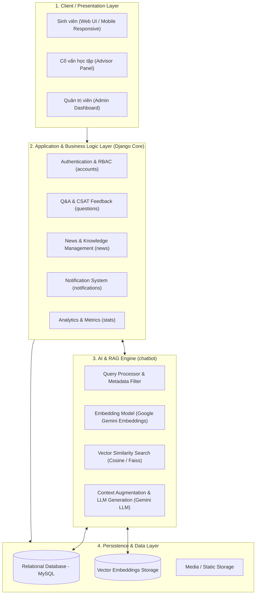

# HỆ THỐNG WEBSITE TƯ VẤN SINH VIÊN (STUDENT ADVISING & SUPPORT SYSTEM)

> **Đề tài:** Xây dựng website hệ thống tư vấn sinh viên tích hợp AI Chatbot RAG (Retrieval-Augmented Generation)

---

## 📌 1. Giới thiệu tổng quan (Overview)

Hệ thống Website Tư vấn Sinh viên là nền tảng trực tuyến toàn diện hỗ trợ giải đáp thắc mắc, quản lý câu hỏi học vụ - đời sống, tin tức và tư vấn tự động cho sinh viên. Hệ thống kết hợp giữa **tư vấn viên/cố vấn học tập thực tế** và **trợ lý AI thông minh tích hợp công nghệ RAG (Retrieval-Augmented Generation)** nhằm phản hồi sinh viên 24/7 với độ chính xác cao dựa trên dữ liệu quy chế và tin tức nhà trường.

### Các phân hệ chính:
- **Cổng thông tin sinh viên (Student Portal):** Đặt câu hỏi (hỗ trợ ẩn danh), tra cứu hỏi đáp, đánh giá độ hài lòng (CSAT), xem tin tức học vụ, tra cứu thông tin khoa/ngành.
- **Trợ lý AI Chatbot (AI Advisor):** Trả lời tự động dựa trên semantic search và pipeline RAG (Gemini API + Vector Embeddings), tự động lọc theo Khoa/Ngành/Danh mục.
- **Phân hệ Cố vấn học tập (Advisor Workspace):** Tiếp nhận câu hỏi thuộc khoa/ngành phụ trách, trả lời câu hỏi, kiểm duyệt nội dung.
- **Cổng quản trị (Admin Dashboard & Management):** Quản lý người dùng, phân quyền cố vấn, quản lý danh mục/khoa/ngành, kiểm duyệt tin tức và báo cáo thống kê tương tác.

---

## 🏛️ 2. Kiến trúc hệ thống (System Architecture)

Hệ thống được thiết kế theo mô hình **Layered Architecture (Kiến trúc phân tầng)** kết hợp kiến trúc **RAG Pipeline**:



### Kiến trúc chi tiết luồng RAG Chatbot:
1. **Query & Filtering:** Tiếp nhận câu hỏi từ sinh viên kèm ngữ cảnh Khoa (`dept_id`), Ngành (`major_id`), Danh mục (`category_id`).
2. **Embedding:** Chuyển đổi câu hỏi thành vector embedding qua Google Gemini API.
3. **Retrieval with Fallback:** Truy vấn độ tương đồng Cosine Similarity trên kho dữ liệu `QuestionEmbedding` & `NewsEmbedding`. Cơ chế Fallback tự động nới lỏng bộ lọc nếu không đủ kết quả chặt chẽ.
4. **Augmentation & Generation:** Ghép ngữ cảnh trích xuất vào Prompt và yêu cầu Gemini LLM sinh câu trả lời chuẩn xác, dẫn nguồn minh bạch.

---

## 💻 3. Công nghệ sử dụng (Technology Stack)

| Thành phần | Công nghệ / Thư viện | Vai trò |
| :--- | :--- | :--- |
| **Backend Framework** | **Django 6.x (Python 3.13)** | Xử lý nghiệp vụ chính, ORM, bảo mật, phân quyền, API views |
| **Database** | **MySQL** | Cơ sở dữ liệu quan hệ lưu trữ người dùng, câu hỏi, câu trả lời, tin tức, vector embeddings |
| **AI / LLM Integration** | **Google Gemini API (`google-genai`)** | Mô hình ngôn ngữ lớn (LLM) trả lời tự động và sinh Embeddings |
| **RAG & Search** | **LangChain, Sentence-Transformers, FAISS** | Xử lý văn bản, chunking, tìm kiếm tương đồng vector |
| **Frontend** | **HTML5, CSS3, JavaScript, Bootstrap / Tailwind UI** | Giao diện người dùng thân thiện, chuẩn responsive |
| **UI Components** | **Django Widget Tweaks, Select2** | Tối ưu hóa form nhập liệu và bộ chọn động |
| **Web Scraping & Data** | **BeautifulSoup4, Selenium, Scrapy** | Thu thập dữ liệu quy chế học vụ, tin tức hỗ trợ xây dựng dataset |
| **Tools & Analytics** | **Pandas, Matplotlib, Seaborn** | Thống kê số liệu, phân tích tần suất câu hỏi và độ hài lòng sinh viên |

---

## 📂 4. Cấu trúc thư mục dự án (Project Directory Structure)

```text
├── hssv/
│   ├── accounts/          # Quản lý tài khoản, phân quyền (Admin, Advisor, Student)
│   ├── admin_panel/       # Giao diện quản trị, điều phối câu hỏi, duyệt tin
│   ├── chatbot/           # Module AI RAG, vector search, service giao tiếp Gemini
│   │   ├── services/      # Logic RAG pipeline (rag_service.py), gemini client
│   │   └── models.py      # Vector embeddings cho câu hỏi và tin tức
│   ├── news/              # Quản lý bài viết, cẩm nang, tin tức học đường
│   ├── notifications/     # Hệ thống thông báo thời gian thực khi có phản hồi
│   ├── questions/         # Quản lý hỏi đáp, ẩn danh, đánh giá CSAT, vote câu hỏi
│   ├── stats/             # Báo cáo thống kê, biểu đồ phân tích
│   ├── templates/         # Giao diện HTML (Jinja/Django Templates)
│   ├── static/            # Static files (CSS, JS, Images)
│   ├── staticfiles/       # Static files sau khi collectstatic
│   ├── tuvansinhvien/     # Cấu hình dự án Django (settings, urls, wsgi)
│   ├── dataset.sql        # Bộ dữ liệu mẫu khởi tạo hệ thống
│   ├── requirements.txt   # Danh sách thư viện phụ thuộc
│   └── manage.py          # Django CLI
├── .gitignore             # Danh sách loại trừ khi commit Git
└── README.md              # Tài liệu mô tả dự án
```

---

## 🚀 5. Hướng dẫn cài đặt và chạy thử nghiệm (Setup & Installation)

### 1. Chuẩn bị môi trường
- Python >= 3.10
- MySQL Server >= 8.0

### 2. Cài đặt các gói phụ thuộc
```bash
# Tạo và kích hoạt môi trường ảo (khuyến nghị)
python -m venv venv
venv\Scripts\activate   # Trên Windows

# Cài đặt thư viện
pip install -r hssv/requirements.txt
```

### 3. Cấu hình cơ sở dữ liệu & API Key
Tạo file `.env` hoặc cấu hình trực tiếp trong `hssv/tuvansinhvien/settings.py`:
- Thông tin kết nối MySQL (`NAME`, `USER`, `PASSWORD`, `HOST`, `PORT`).
- Khóa `GEMINI_API_KEY` để kích hoạt tính năng AI Chatbot.

### 4. Migrate và khởi động hệ thống
```bash
cd hssv
python manage.py makemigrations
python manage.py migrate

# Tạo tài khoản quản trị
python manage.py createsuperuser

# Chạy server phát triển
python manage.py runserver
```
Truy cập hệ thống tại: `http://127.0.0.1:8000/`
